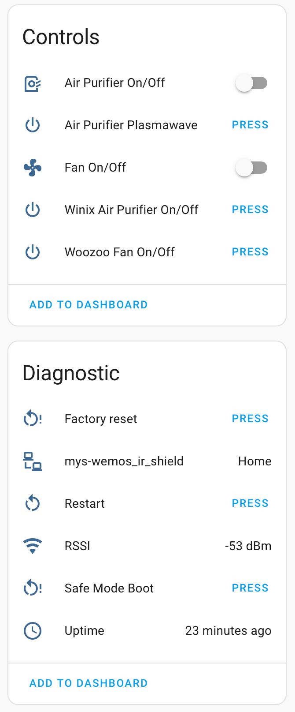
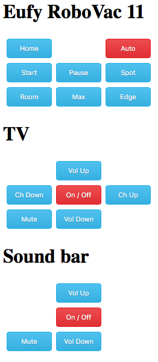
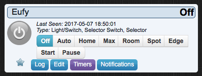

# MySWeMosIRShield - IR blaster shield for WeMos D1 Mini

## ESPHome - For Home Assistant integration

Included program

### myswemosirshield.yaml

Example code for ESPHome allowing an easy integration to Home Assistant.
You will (very probably) need to modify this code with your own IR codes and definitions. See [ESPHome Remote Receiver Component](https://esphome.io/components/remote_receiver.html) and [ESPHome Remote Transmitter Component](https://esphome.io/components/remote_transmitter.html)
This program was created to allow me to control my [WOOZOO Air Circulator Fan](https://amzn.to/4lCFlPL) and [Winix Air Purifier](https://amzn.to/4l8p315) and automate them through Home Assistant.

## Arduino - with HTTP and MySensors support

Included program

### MySWeMosIRShield-RoboVac_TV.ino

Example code implementing custom web server and MySensors support.
You will (very probably) need to modify this code with your own IR codes and definitions.
This program was created to allow me to control my [Eufy RoboVac 11 robotic vacuum cleaner](http://amzn.to/2pbbndL) which unfortunately by default lack of any advanced scheduling options. By default, this vacuum cleaner will start its "auto" mode every day at the same hour, but can now be scheduled to operate only certain days, at different times, or even using different modes.

This program will set up a web server on your WeMos that you can access from any other device on your local network or by connecting directly to the ESP8266 hotspot (depending on WiFi settings) allowing you to trigger IR commands.
Interface is optimized for access through a smartphone, allowing you to use it as a smart remote.

It will also create a [MySensors](http://www.mysensors.org) node behaving like a selector switch. You can then program it to perform various actions through your controller.

## Improving the code

If you have a great program using this hardware feel free to contact me or push a commit to add other examples.
